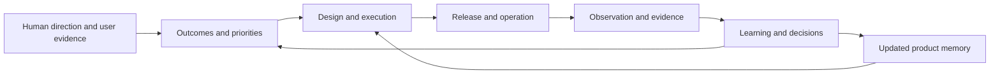

# ProductOS

**The shared operating system where humans and AI steer, build, operate, and evolve products together.**

ProductOS is a portable product management method expressed in Markdown. It connects purpose and priorities to execution, evidence, and learning so the next person or agent can continue with context.

Its central convention is **[PRODUCT.md](docs/PRODUCT_MD.md)**: the shared product contract describing what a product should become, for whom, why it matters, and how it will evolve.

## Start here

- [What is ProductOS?](docs/WHAT_IS_PRODUCTOS.md) — purpose, principles, and the learning loop.
- [Quickstart](docs/QUICKSTART.md) — add a clean instance to a new or existing project.
- [Bare template](template/product/README.md) — copy this folder into your project as `product/`.
- [Operating guide](docs/OPERATING_GUIDE.md) — how humans and agents work together day to day.
- [Worked example](examples/first-learning-loop.md) — a fictional experiment from user problem to decision.

## Adopt it

From a checkout of this repository, with an existing target repository and no `product/` directory:

```sh
test ! -e ../my-project/product && cp -R template/product ../my-project/product
```

Then open `product/PRODUCT.md`, fill in the facts you know, choose one outcome, and update `product/STATE.md`. Keep unknowns explicit. The [quickstart](docs/QUICKSTART.md) explains how to connect your root agent instructions and complete the first loop.

## The model



`PRODUCT.md` explains product intent. `AGENTS.md` explains how agents work. `STATE.md` makes work resumable. The roadmap, specifications, experiments, decisions, and operations records provide detail as needed.

## This repository and your project

| Location | Purpose |
| --- | --- |
| [docs/](docs/README.md) | Guides to the method, contract, adoption, collaboration, and automation |
| [template/product/](template/product/README.md) | A blank, self-contained ProductOS instance |
| [examples/](examples/README.md) | Explicitly fictional illustrations; never live project data |
| [AGENTS.md](AGENTS.md) | Instructions for maintaining this framework repository |

The template contains no product decisions, evidence, assigned work, or inherited permissions. Your project owns the facts and history after adoption. You can adapt it without a hosted service or a particular model, framework, or database.

ProductOS defines the memory and operating protocol. Continuous autonomous execution additionally needs an actual runner, authorized tools, event sources, and working observation. See [automation](docs/AUTOMATION.md).

Current release: [0.1.0](CHANGELOG.md). See [customization](docs/CUSTOMIZATION.md) for adapting and upgrading an instance.
