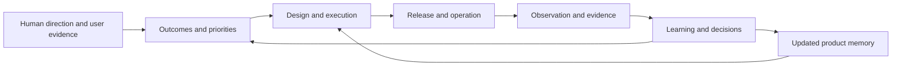

# ProductOS

**The shared operating system where humans and AI steer, build, operate, and evolve products together.**

ProductOS is a portable product management method expressed in Markdown. It connects purpose and priorities to execution, evidence, and learning so the next person or agent can continue with context.

Its central convention is **[PRODUCT.md](docs/PRODUCT_MD.md)**: the shared product contract describing what a product should become, for whom, why it matters, and how it will evolve. ProductOS 0.2 makes that contract a superset of the [open PRODUCT.md standard](https://product.md/) while keeping outcomes, operations, and learning in linked records.

## Start here

- [What is ProductOS?](docs/WHAT_IS_PRODUCTOS.md) — purpose, principles, and the learning loop.
- [Quickstart](docs/QUICKSTART.md) — add a clean instance to a new or existing project.
- [Bare template](template/product/README.md) — copy this folder into your project as `product/`.
- [Operating guide](docs/OPERATING_GUIDE.md) — how humans and agents work together day to day.
- [Worked example](examples/first-learning-loop.md) — a fictional experiment from user problem to decision.

## Adopt it

From this checkout, install the skill into an existing target project. Add `--agent claude` for Claude Code or `--agent both`; the default is Codex:

```sh
python3 scripts/install_skill.py --project ../my-project
```

Open that project in Codex and invoke `$product-os init`, or `/product-os init` in Claude Code. Claude Code previews the entries as you type:

```text
/product-os  [init|resume|orient] [target or question]
```

ProductOS reads existing context, then asks you about the vision, users, requirements, constraints, success criteria, and priorities still needed for a complete initial brief. It helps you decide when you are unsure, saves progress between rounds, and ends with a Now / Next / Later roadmap and a proposed first loop.

New projects get a shared root `PRODUCT.md` and supporting context under `product/`. Existing product contracts and history are preserved. Installing the skill does not initialize a product or start a loop.

The [quickstart](docs/QUICKSTART.md) includes manual skill installation and a portable prompt workflow for other agents. No hosted service or agent runtime is required to use the documentation model.

## The model



`PRODUCT.md` explains product intent. `AGENTS.md` explains how agents work. `STATE.md` makes work resumable. The roadmap, specifications, experiments, decisions, and operations records provide detail as needed.

## This repository and your project

| Location | Purpose |
| --- | --- |
| [docs/](docs/README.md) | Guides to the method, contract, adoption, collaboration, and automation |
| [template/product/](template/product/README.md) | A blank, self-contained ProductOS instance |
| [skills/product-os/](skills/product-os/SKILL.md) | Onboarding skill entrypoint; the installer bundles the template as assets |
| [examples/](examples/README.md) | Explicitly fictional illustrations; never live project data |
| [AGENTS.md](AGENTS.md) | Instructions for maintaining this framework repository |
| [VERSION](VERSION) | Framework release; changing it on `main` [releases](docs/RELEASING.md) that version |

The template contains no product decisions, evidence, assigned work, or inherited permissions. Your project owns the facts and history after adoption. You can adapt it without a hosted service or a particular model, framework, or database.

ProductOS defines the memory and operating protocol. Continuous autonomous execution additionally needs an actual runner, authorized tools, event sources, and working observation. See [automation](docs/AUTOMATION.md).

Current release: [0.3.0](CHANGELOG.md). See [customization](docs/CUSTOMIZATION.md) for adapting and upgrading an instance.
